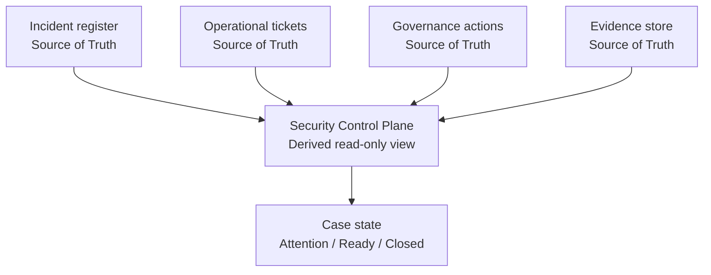

# Security Control Plane — Portfolio Integration Demo

Public-safe clean-room demonstration of a lightweight security operations control plane for a small regulated IT or MSP environment.

The demo connects four kinds of work that are often stored and closed separately:

- security incidents;
- operational tickets;
- governance and privacy actions; and
- audit evidence.

Its central rule is simple:

> Closing the technical ticket must not silently close an unfinished governance, privacy or evidence obligation.

This repository contains only fictional data. It is not copied from an employer or customer system and does not expose production schemas, incidents, identities, URLs or configuration.

## Why this exists

In a fragmented operating environment, a technical incident can be resolved while a related privacy assessment, corrective action or evidence requirement remains open. Individual source systems may each be correct, but the organization can still lose the relationship between them.

This demo provides a derived, read-only control view across those records. It keeps each system's ownership intact while making cross-system obligations visible.

## What it demonstrates

- business analysis translated into explicit requirements and acceptance criteria;
- Source of Truth boundaries and read-only integration principles;
- a relational model connecting incidents, tickets, actions and evidence;
- deterministic validation of references and lifecycle state;
- exception logic for technically closed but operationally unfinished cases;
- human-owned approval and closure decisions; and
- portfolio-safe synthetic data and automated tests.

## Related portfolio projects

The Security Control Plane is an integration layer, not a duplicate of the projects below.

| Project | Responsibility | Relationship to this demo |
|---|---|---|
| [Operations as a Service Blueprint](https://github.com/Jonnenpijonne/operations-as-a-service-blueprint) | Operational ownership, incidents, escalation, recovery and service evidence | Defines how work is owned and operated |
| [Infrastructure Change Quality Gate](https://github.com/Jonnenpijonne/infrastructure-change-quality-gate) | Risk-based change validation, approvals and audit evidence | Provides the change-control and evidence-gate pattern |
| [Governed Knowledge Base](https://github.com/Jonnenpijonne/governed-knowledge-base-portfolio) | Source of Truth boundaries, ADRs, metadata and AI limits | Provides the governed knowledge and decision-boundary pattern |
| [RBAC-Lite](https://github.com/Jonnenpijonne/RBAC-Lite) | Access-control and tenant-isolation example | Provides an example domain for access-governance actions |



The control plane stores references and derives status. It does not become the master record for incidents, tickets, approvals or evidence.

## Demonstrated scenario

The synthetic dataset includes two cases:

1. `INC-001`: the operational ticket is closed, but a privacy assessment and required evidence remain open. The derived case state is `ATTENTION_REQUIRED`.
2. `INC-002`: the incident, ticket, governance action and required evidence are all complete. The derived case state is `CLOSED`.

This makes the difference between **technical resolution** and **organizational completion** explicit and testable.

## Run the demo

Python 3.11 or newer is recommended. The project uses only the Python standard library.

```bash
python scripts/validate_relationships.py
python -m unittest discover -s tests -p 'test_*.py'
```

Expected summary:

```text
INC-001: ATTENTION_REQUIRED
INC-002: CLOSED
Validation passed: all references and lifecycle rules are consistent.
```

## Repository map

```text
docs/
  BUSINESS_PROBLEM.md
  REQUIREMENTS.md
  ARCHITECTURE.md
  DATA_MODEL.md
  LIFECYCLE_AND_EXCEPTIONS.md
  CLAIMS_AND_BOUNDARIES.md
examples/synthetic/
  incidents.json
  operational-tickets.json
  governance-actions.json
  evidence.json
scripts/
  validate_relationships.py
tests/
  test_validate_relationships.py
```

## AI boundary

AI may summarize records, propose classifications or help an analyst identify missing relationships. It may not:

- approve or close an incident;
- change an authoritative source record;
- declare evidence sufficient;
- infer authority from access; or
- override deterministic validation and accountable human review.

## Status and claim boundary

This is a portfolio/reference implementation. It is not a production SOC, SIEM, GRC system, incident-response platform or compliance claim. See [Claims and boundaries](docs/CLAIMS_AND_BOUNDARIES.md).

## License

MIT. See [LICENSE](LICENSE).
