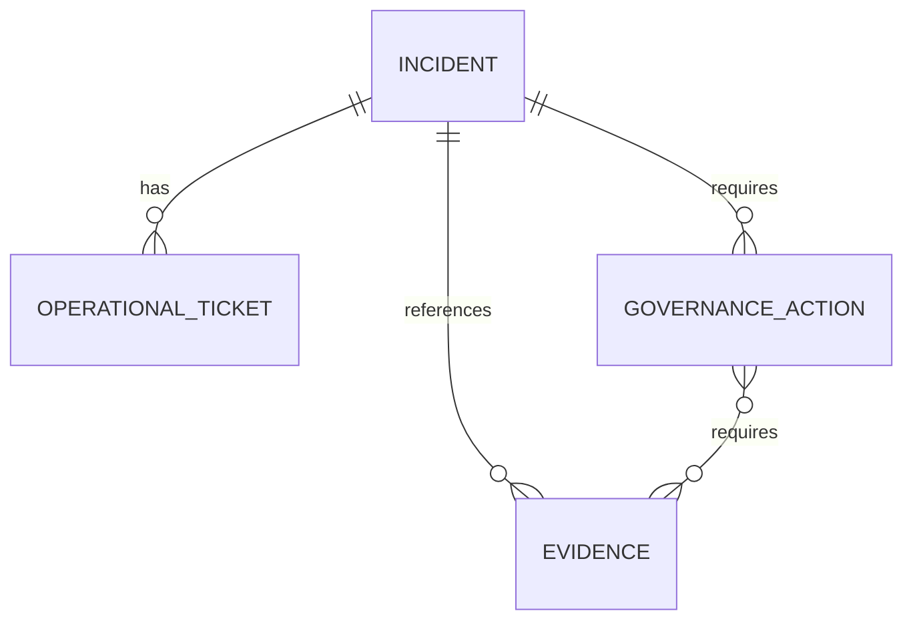

# Data Model

## Entities

### Incident

Represents the security event in its authoritative incident register.

Required fields:

- `id`
- `title`
- `technical_status`
- `severity`
- `owner`
- `source_system`
- related record identifier lists

### Operational ticket

Represents investigation, containment, remediation or other technical work.

Required fields:

- `id`
- `incident_id`
- `status`
- `owner`
- `source_system`

### Governance action

Represents privacy, risk, policy, corrective-action or management follow-up that has an independent owner and lifecycle.

Required fields:

- `id`
- `incident_id`
- `type`
- `status`
- `owner`
- `required_evidence_ids`
- `source_system`

### Evidence

Represents a required, submitted or verified evidence item. In a real system, sensitive evidence would remain in an approved evidence store; the control plane would retain only a scoped reference and status.

Required fields:

- `id`
- `incident_id`
- `type`
- `status`
- `owner`
- `source_system`

## Relationships

## Derived case state

The control-plane case state is not a fifth Source of Truth. It is a reproducible interpretation of the linked source statuses.

| Derived state | Meaning |
|---|---|
| `ATTENTION_REQUIRED` | At least one technical, governance or required evidence dependency remains unfinished |
| `CLOSED` | Incident, related tickets, governance actions and required evidence are complete |

Future versions could introduce `IN_PROGRESS`, `READY_FOR_REVIEW` or `BLOCKED`, but this demo intentionally keeps the decision model small and testable.
